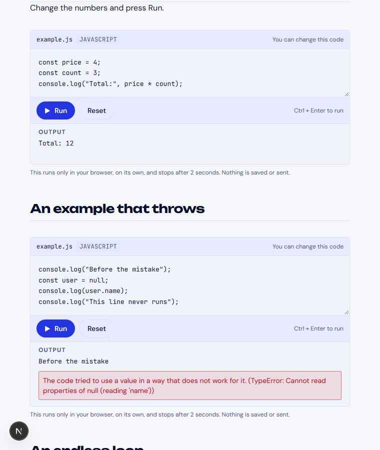
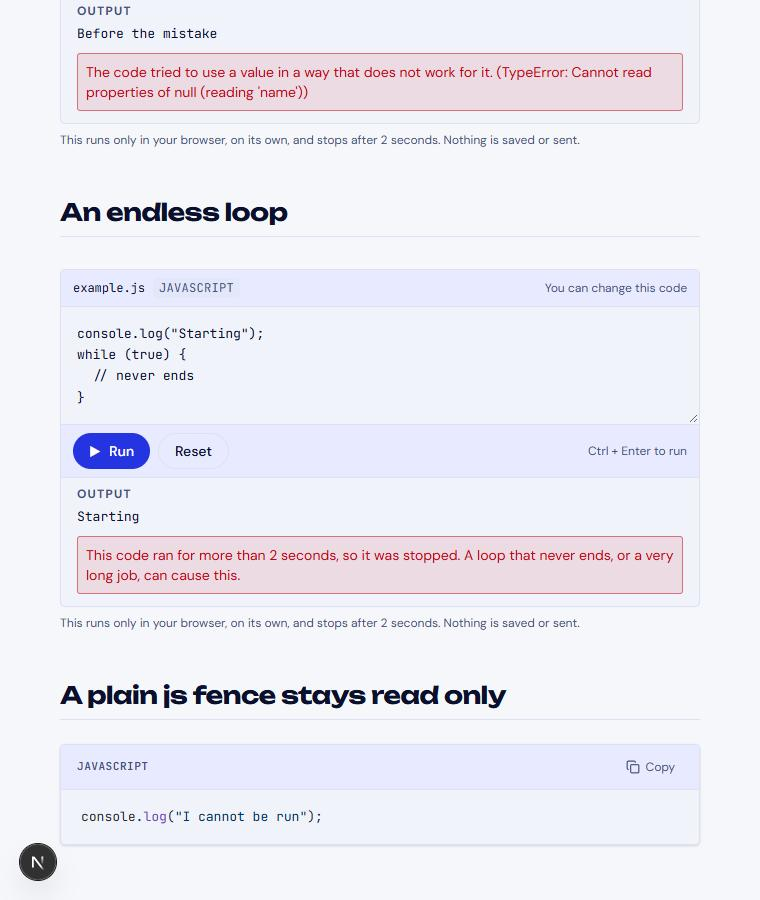
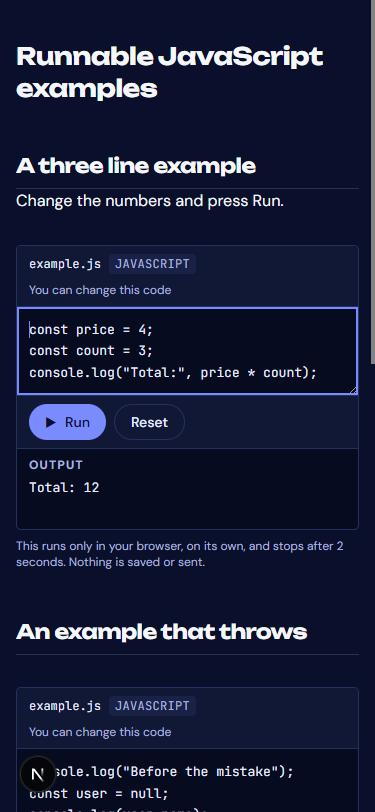

# Runnable JavaScript example

A learner can change a small JavaScript example and run it where they read it, with no tests, no server and no grade. Use it for three or four line examples in beginner chapters. For anything that must be checked, use a graded code exercise.

## How an author marks an example

Add the word `run` after the language on a normal code fence:

````md
```js run
const price = 4;
const count = 3;
console.log("Total:", price * count);
```
````

- `js run` and `javascript run` both work.
- A plain `js` fence is not changed. It stays a read-only code block with the copy button.
- The fence must hold some code and at most 4000 characters. The course source check and the import both fail with a plain message otherwise.
- Use `console.log` (also `info`, `warn`, `error`) to print. The learner sees each line in order.
- Do not write imports, `await` at the top level, `document` or `window`. The code runs in a worker, with no page.

## What the learner sees

A small editor with the code, a Run button (also Ctrl or Cmd + Enter), a Reset button that puts the original code back, and an Output area.

- Printed lines appear in order. Warnings and errors from `console.warn` and `console.error` are labelled.
- If the code throws, the lines printed before it stay, and a message in plain words follows, for example "The code tried to use a value in a way that does not work for it. (TypeError: Cannot read properties of null (reading 'name'))".
- Code that runs longer than 2 seconds is stopped with a clear message. This catches endless loops.
- At most 200 lines are kept, each at most 500 characters. The learner is told when output was left out.

## How it stays safe

- The code runs only in the learner's browser, in a Web Worker made from a Blob. A worker has no page, so it cannot reach the DOM, cookies, localStorage or the learner's session.
- Before the example runs, the worker script removes `fetch`, `XMLHttpRequest`, `WebSocket`, `EventSource`, `importScripts`, `Worker`, `SharedWorker`, `BroadcastChannel`, `indexedDB`, `caches` and `postMessage`, so an example cannot send anything out or start another worker.
- After the time limit the worker is terminated.
- Nothing is sent to the server, graded or stored.

This is a guard for teaching examples, not a hardened sandbox for hostile code. Only authors write these examples, and learners can only change them in their own browser tab.

## Where the code is

| What | Where |
| --- | --- |
| Fence rules and limits | `server/src/shared/runnable-js/spec.ts` (copied to the frontend and `packages/learning-ui` by `pnpm sync-shared`) |
| Fence to `<RunnableJs code="..." />` | `server/src/shared/mdx/remark-runnable-js.ts`, in `readerRemarkPlugins` and the source check |
| Runner (worker script, time limit, output cap, error words) | `packages/learning-ui/src/lib/run-js.ts` |
| Reader block | `packages/learning-ui/src/components/learn/content-blocks/runnable-js.tsx`, registered in `lesson-blocks.tsx` for web and desktop |
| Tests | `server/tests/unit/shared/mdx/runnable-js.test.ts`, `frontend/tests/unit/learn/run-js.test.ts` |
| Specimen page for a local run | `/zz-runjs-gallery` in the frontend |

The publisher in Edorax-core carries its own copy of the validation (see `docs/course-publish.md` there), so the same fence is accepted when a course is published.

## Screenshots from a local run




